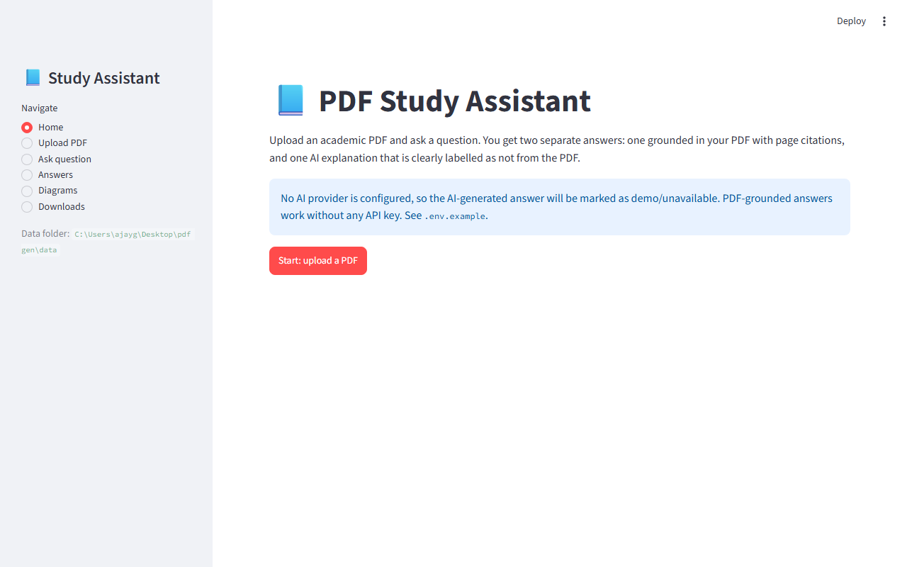
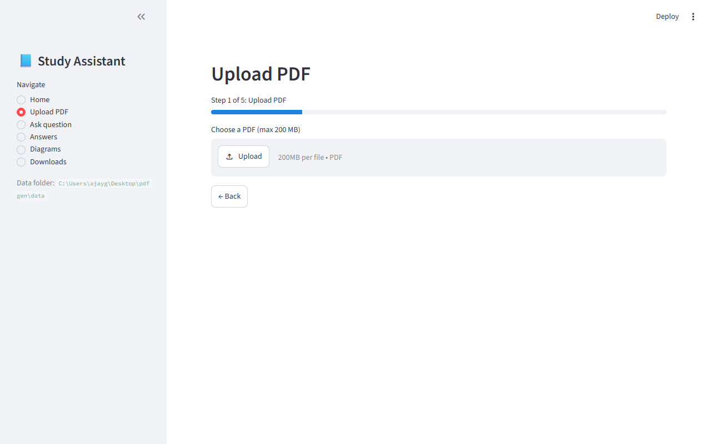
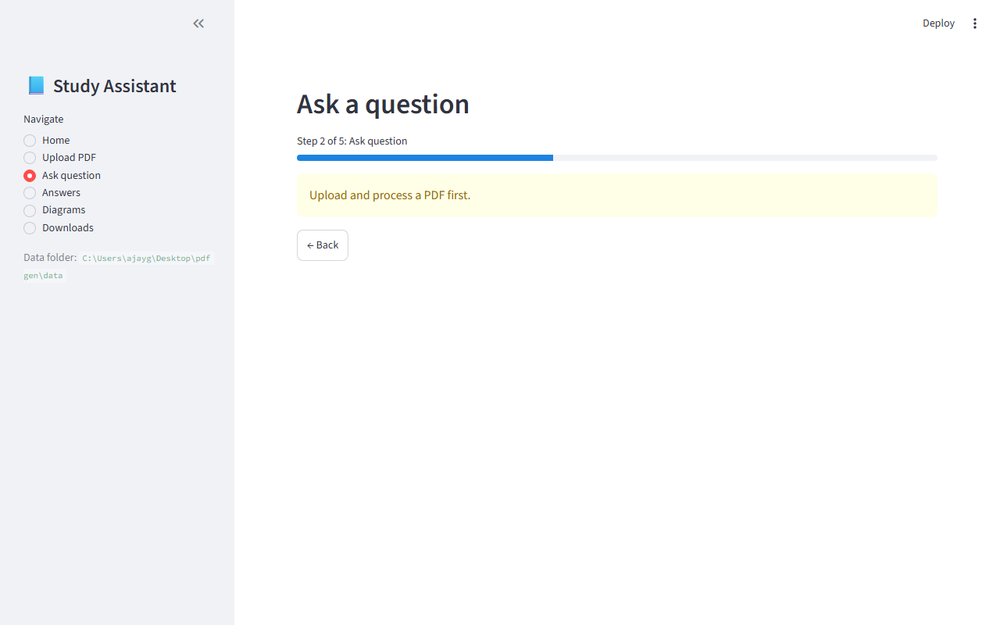
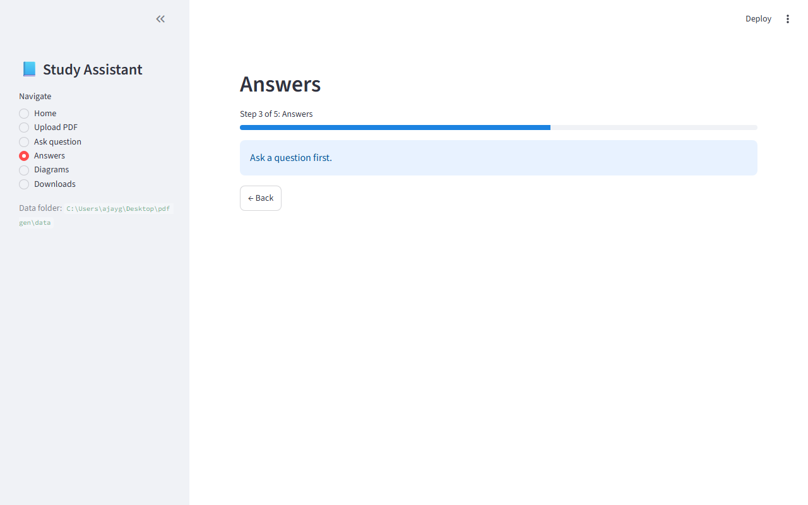
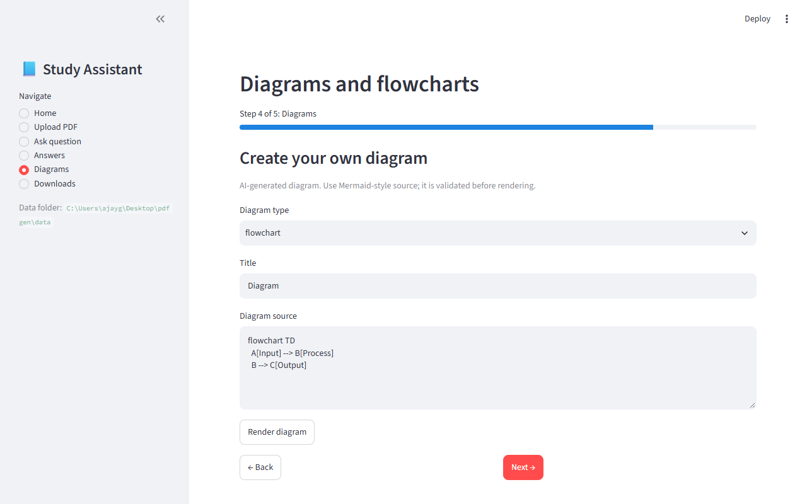
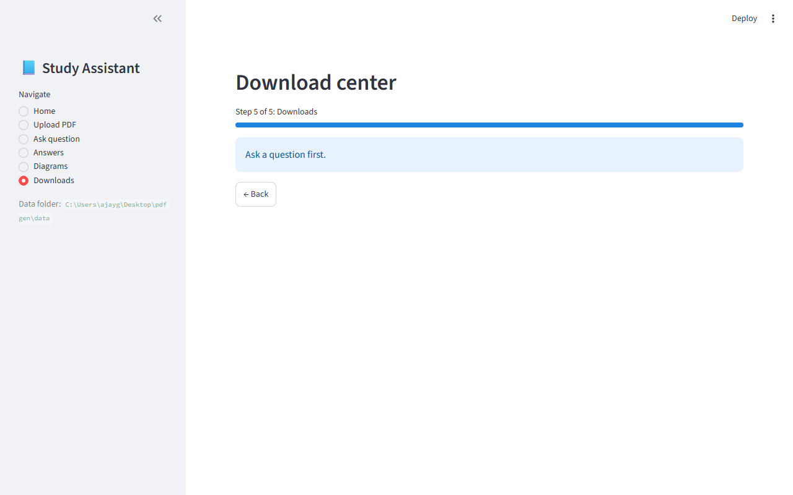

# PDF Study Intelligence

A Python-only **PDF study assistant** for students. Upload an academic PDF, ask a
question in plain English, and get two clearly separated answers:

- **PDF-grounded answer** — built only from passages retrieved from your PDF,
  with page-level citations. If the PDF does not contain the answer, the app
  says so instead of guessing.
- **AI-generated answer** — a separate explanation, explicitly labelled as not
  taken from the PDF. Only produced when an AI provider is configured.

Everything runs locally in a single Streamlit app — no Node.js, no frontend
build step, no external services required for the core workflow.

## Features

- **PDF upload & ingestion** — up to 200 MB, page-by-page text extraction with
  page numbers preserved, duplicate/corruption validation, and clear warnings
  for scanned or image-only pages.
- **Lexical retrieval** — keyword search across the whole document with
  page citations on every answer.
- **Evidence analysis** — answers are classified as *supported*, *partial*, or
  *insufficient evidence* based on how well the retrieved passages cover the
  question.
- **Honest AI separation** — the PDF-grounded answer and the AI supplementary
  note are generated and displayed separately; nothing is passed off as
  PDF-sourced when it isn't.
- **Diagrams** — Mermaid-style flowcharts/sequence/architecture diagrams
  rendered to SVG (via mermaid.ink when online, with a built-in offline
  renderer for flowcharts), plus original figures extracted from the PDF.
- **Exports** — every answer downloads as a formatted **PDF report** (with
  page numbers and header/footer), **DOCX**, **Markdown**, or **TXT**.
- **Document & answer history** — previously uploaded PDFs can be reopened or
  deleted; past questions and answers can be revisited and exported at any
  time.
- **Optional AI provider** — OpenAI-compatible chat API via `.env`; the app
  works fully without one.

## Tech stack

| Layer | Technology |
| --- | --- |
| UI | Streamlit (Python) |
| PDF parsing | pypdf, Pillow |
| PDF reports | ReportLab |
| DOCX reports | python-docx |
| Storage | SQLite (metadata, pages, chunks, Q&A history) + local filesystem |
| AI | Optional OpenAI-compatible HTTP API (httpx) |
| Tests | pytest + Streamlit AppTest |

## Setup (Windows PowerShell)

```powershell
git clone <your-repo-url> pdf-study-intelligence
cd pdf-study-intelligence
py -3.13 -m venv .venv
.\.venv\Scripts\Activate.ps1
python -m pip install -r requirements.txt
```

### Optional: enable the AI-generated answer

Copy `.env.example` to `.env` and fill in your provider details:

```env
AI_PROVIDER=openai-compatible
AI_API_KEY=your-key-here
AI_BASE_URL=https://api.openai.com/v1
AI_MODEL=gpt-4o-mini
```

Keys stay on your machine and are never shown in the UI or sent anywhere except
your configured provider. Without a provider, PDF-grounded answers still work;
the AI panel simply reports itself as unavailable.

## Run

```powershell
.\.venv\Scripts\python.exe -m streamlit run app.py
```

Then open the URL Streamlit prints (default `http://localhost:8501`).

**Workflow:** Home → Upload PDF → Ask question → Answers → Diagrams →
Documents / Downloads. Navigation is also available in the sidebar.

## Tests

```powershell
.\.venv\Scripts\python.exe -m pytest tests -q
```

The suite covers PDF ingestion (multi-page generated PDFs), page citations,
invalid-upload rejection, evidence classification, diagram SVG rendering
(online and offline paths), all four export formats, document management, and
Streamlit UI smoke tests.

## Project structure

```
├── app.py                  # Streamlit UI (pages, navigation, session state)
├── .streamlit/config.toml  # App theme
├── backend/
│   ├── pipeline.py         # Service layer: ingest, ask, diagram, export, documents
│   ├── pdf_extractor.py    # pypdf text/image extraction, validation
│   ├── chunking.py         # Page text → overlapping chunks
│   ├── document_store.py   # SQLite persistence (docs, pages, chunks, Q&A, exports)
│   ├── retrieval.py        # Lexical search + context assembly
│   ├── evidence.py         # Coverage analysis & citation building
│   ├── answer_generation.py# PDF-grounded + AI answer drafting
│   ├── ai_provider.py      # Optional OpenAI-compatible provider
│   ├── diagrams.py         # Mermaid validation, mermaid.ink + offline SVG renderer
│   ├── export_engine.py    # PDF / DOCX / Markdown / TXT report generation
│   ├── models.py           # Dataclasses
│   ├── config.py           # Env-based configuration
│   └── exceptions.py       # Typed application errors
├── tests/                  # pytest suite
├── docs/screenshots/       # UI screenshots
├── data/                   # Runtime data (git-ignored): uploads, store.db, exports
├── requirements.txt
└── .env.example
```

## Screenshots

| Page | Preview |
| --- | --- |
| Home |  |
| Upload PDF |  |
| Ask question |  |
| Answers |  |
| Diagrams |  |
| Downloads |  |

## Privacy

PDFs and generated files are stored locally under `data/` (git-ignored).
Nothing leaves your machine unless you configure an AI provider — and then only
the question and retrieved passages are sent to it.

## Known limitations

- **No OCR** — scanned PDFs without a text layer produce little or no text;
  the app warns you about image-only pages.
- **Lexical retrieval** — keyword-based search; no embeddings or reranking yet.
- **AI answers need a provider** — without one, the AI panel is honestly marked
  unavailable rather than faked.
- **Sequence/architecture diagrams** need network access (mermaid.ink); simple
  flowcharts render fully offline.

## Roadmap

- OCR fallback for scanned PDFs (e.g. Tesseract).
- Embedding-based retrieval with reranking.
- More diagram types rendered locally.
- Page-range filtering for questions.

## License

MIT — see [LICENSE](LICENSE).
